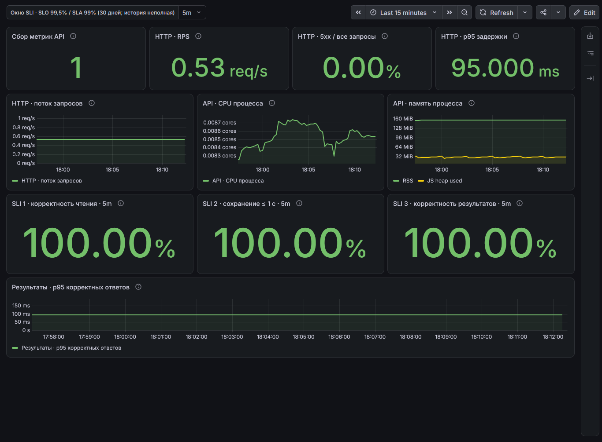

# Grafana Raincheck

## Источники данных

Запустил Grafana через Helm и подключил VictoriaMetrics как Prometheus datasource. Настройки находятся в [95-grafana-values.yaml](k8s/95-grafana-values.yaml).

VictoriaMetrics хранит метрики, которые собирает vmagent: HTTP-метрики backend, метрики процесса Node.js, результаты проверок пробера и метрики PostgreSQL Exporter. Grafana получает их из одного источника данных.

## Панели приложения

Собрал [дашборд Raincheck](k8s/dashboards/raincheck-grafana.json) из 9 панелей. Сначала показал состояние API и запросы, затем ресурсы и проверки пробера.

- **Сбор метрик API.** Показывает, удаётся ли vmagent собирать метрики приложения. Значение `up` равно 1 при успешном сборе со всех наблюдаемых экземпляров API и 0 при ошибке хотя бы одного. Выбрал эту панель для контроля самого сбора данных.
- **HTTP RPS.** Число HTTP-запросов в секунду, среднее за 5 минут (Rate в RED)
- **HTTP 5xx.** Доля ответов с серверной ошибкой за 5 минут (Errors в RED). Без запросов значение отсутствует.
- **HTTP p95.** Оценка 95-го перцентиля времени HTTP-ответа по гистограмме за 5 минут. Показывает задержку (Duration в RED)
- **CPU API.** Использование CPU процессами API в ядрах. Показывает загрузку процессора
- **Память API.** RSS и используемая память JS heap. Позволяет следить за потреблением памяти
- **SLI 1: чтение опроса.** Пробер запрашивает тестовый опрос и проверяет, что вернулся нужный идентификатор и опрос открыт для ответов (`OPEN`). Панель показывает долю корректных чтений: `(success + slow) / все проверки × 100%`. Медленный, но правильный ответ учитывается как успешный.
- **SLI 2: сохранение доступности ≤1 с.** Пробер удаляет предыдущий тестовый ответ, читает данные участника и интервалы опроса, создаёт черновик ответа и сохраняет в нём первый интервал с отметкой «при необходимости». Затем повторно читает ответ и сверяет сохранённый интервал, идентификатор и статус черновика. Панель показывает долю проверок, в которых весь сценарий корректно завершился не более чем за 1 секунду: `success / все проверки * 100%`.
- **SLI 3: получение результатов.** Пробер запрашивает результаты тестового опроса. Проверяет участника со статусом черновика, отсутствие подтверждённых ответов и подходящих интервалов, а также нулевые значения тепловой карты для интервалов опроса. Панель показывает долю корректных результатов: `(success + slow) / все проверки * 100%`. Если подготовка ответа или чтение опроса завершились ошибкой, проверка результатов тоже считается неуспешной.

## Почему выбрал эти метрики

Базовые панели выбрал по RED, USE: они показывают поток запросов, ошибки, задержку и потребление ресурсов. Так можно сопоставить ухудшение работы API с нагрузкой и использованием CPU или памяти.

Панели пользовательских операций выбрал на основании SLI/SLO/SLA из предыдущего задания. Они показывают, может ли участник прочитать опрос, сохранить свою доступность и получить корректные результаты. В отличие от общего числа HTTP-ошибок, эти показатели учитывают содержимое ответа и проверку сохранённых данных.

Пороги панелей взял из тех же требований. При отсутствии проверок показывается `No data`.

## PostgreSQL

Использовал Postgres Overview из [репозитория postgres_exporter](https://github.com/prometheus-community/postgres_exporter/blob/v0.18.1/postgres_mixin/dashboards/postgres-overview.json), по версии экспортера. Локальный JSON и дашборд Raincheck автоматически загружаются через Helm в папку `Raincheck`. Источник данных: VictoriaMetrics.

Запросы сохранены из исходного дашборда.
