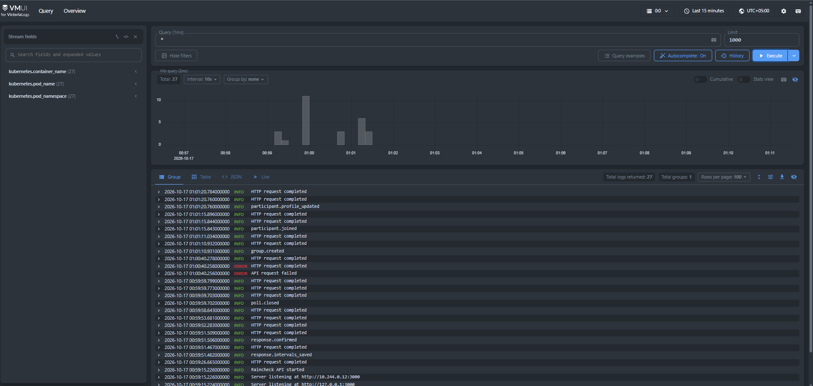
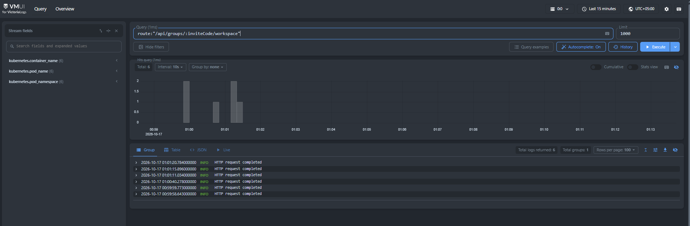
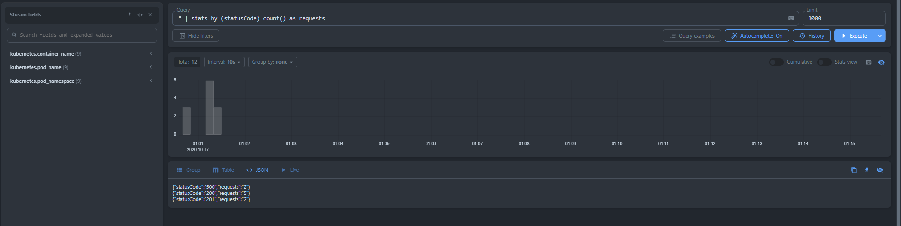
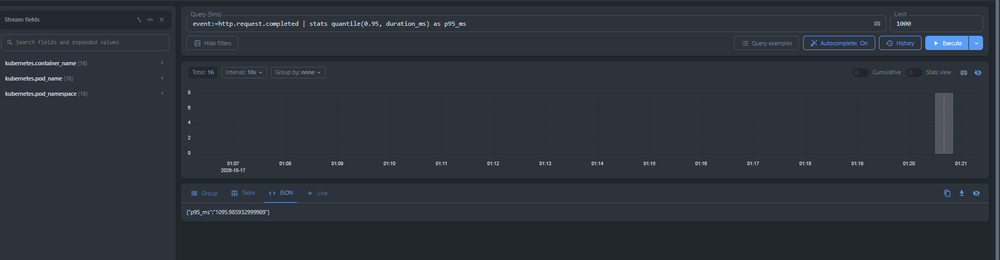

# Victoria Logs

Команды выполняйте из корня проекта. Minikube и приложение в namespace `raincheck` должны быть запущены по инструкции [README.md](README.md).

1. Просмотр логов

```sh
kubectl logs deployment/api -n raincheck

```

2. VictoriaLogs настраивал через Helm

Helm values vls:

```
server:
  persistentVolume:
    size: 5Gi
  retentionPeriod: 7d
```

Helm values collector:

```
collector:
  excludeFilter: not (kubernetes.pod_namespace:=raincheck and kubernetes.pod_labels.app:=api)
remoteWrite:
- url: http://vls-victoria-logs-single-server:9428
```

Для доставки логов использовал vlagent, установленный через Helm-chart victoria-logs-collector как DaemonSet. Выбрал этот способ, потому что приложение уже пишет JSON в stdout. Через фильтр ограничил сбор только логами бэкэнда.

3. UI VictoriaLogs

```powershell
kubectl port-forward -n raincheck service/vls-victoria-logs-single-server 9428:9428
```

http://localhost:9428/select/vmui/ - ui

LogsQL-запросы:

1. Записи логов за последние 15 минут



2. Записи запросов по маршруту /api/groups/:inviteCode/workspace

```
route:"/api/groups/:inviteCode/workspace"
```



3. Количество записей для каждого HTTP-статуса

```
* | stats by (statusCode) count() as requests
```



4. p95 времени обработки HTTP-запросов в миллисекундах

```
event:=http.request.completed | stats quantile(0.95, duration_ms) as p95_ms
```


